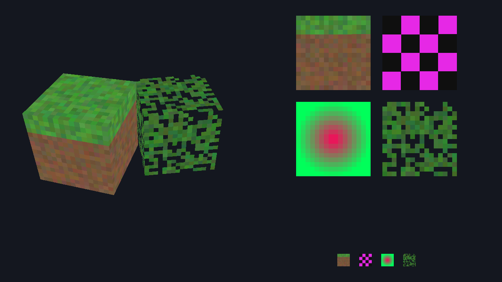

# 0002 - Texture storage: 2D array vs atlas

- Status: accepted
- Date: 2026-11-25
- Decides for: 1.4 (block registry, textures), 1.6 (mesher UVs), 1.12 (AO/lighting tint)

## Decision

Store block textures in a **`GL_TEXTURE_2D_ARRAY`**: one layer per texture, **16x16
RGBA8**, `MAG_FILTER = NEAREST`, `MIN_FILTER = NEAREST_MIPMAP_LINEAR` with mipmaps
generated per layer. Every face of a block references a **layer index**, never a UV
rectangle. No atlas, no padding, no half-texel offsets.

Transparency: opaque and alpha-cutout geometry share one pass, cutout done with
`discard` on `a < 0.5` (leaves). Blended transparency (water, glass) gets its own
back-to-front pass later.

GL 4.6 core is already required by 0001, so `sampler2DArray` costs nothing.

## Why not an atlas

| | Array texture | Atlas |
|---|---|---|
| bleeding | impossible, layers are independent | needs padding/extrusion, or mips bleed neighbours |
| UVs | always 0..1 per face | offset arithmetic, half-texel battles |
| mipmaps | per layer, correct by construction | bleed unless every tile is padded and mips generated by hand |
| texture filtering at tile edges | no cross-talk | `GL_REPEAT` breaks, clamp smears |
| memory | 1 KB per 16x16 layer | same pixels, plus padding waste |
| max size | 8192 layers on this GPU | one 16384-wide image has to hold every tile |

The atlas wins only if we needed per-tile wrapping of a single huge texture, which a
block game does not: every face samples exactly one tile.

## Layer budget

- 16 x 16 x 4 bytes = **1 KB per layer**. 64 block faces = 64 KB total.
- `MAX_ARRAY_TEXTURE_LAYERS` = 8192 on the RX 9070 XT, so the limit is irrelevant;
  the practical limit is how many textures we are willing to author.
- Grass tint (biome colour) should be a uniform per draw or a vertex attribute, not
  extra layers, so one grass texture serves every biome.

## Row order (hit in the spike)

GL samples `v = 0` at the **bottom** of the image, PNG rows are stored **top-down**.
The first probe build drew the grass cap on the bottom of every side face until the
layer generation put the cap in the high rows. When real PNGs arrive in 1.4, flip the
rows on upload (or generate the array bottom-up) and keep it in one place.

## Probe results

Throwaway probe at `~/voxel-spikes/texprobe` on burken: SDL3 window, GL 4.6 core
context, zigglgen bindings, 7 generated 16x16 layers uploaded with a single
`glTexImage3D`, cube + magnified tiles + minified mipmapped row.

- renderer: AMD Radeon RX 9070 XT, Mesa 25.2.8, GL 4.6 core
- `MAX_ARRAY_TEXTURE_LAYERS` 8192, `MAX_TEXTURE_SIZE` 16384
- 120 fps with vsync, no GL errors
- nearest magnification: hard pixel edges, no colour from neighbouring layers at any
  tile border (the magenta/black checker is the tell)
- mipmapped minification (32 px row): clean, no bleed
- alpha cutout: leaves show holes with the cube behind visible through them

The probe also gained a `--shot` mode: it renders one frame into a hidden window and
writes a PPM to stdout, so evidence can be captured without stealing focus from
whatever is on the desktop. Worth keeping for later visual checks.

## Consequences

- Vertex format carries `uv: [2]f32` + `layer: f32` (proved in the probe, 24 bytes
  per vertex). 1.4 can pack it later (u16 UV + u8 layer in two u32s) once the mesher
  exists; the mesher only needs to emit a layer per face.
- The block registry (1.4) maps `BlockId` -> {top, side, bottom} layer indices.
- Textures are authored as one PNG per layer in `assets/blocks/`, flipped on upload.
- Mipmapping is decided per texture array, not per tile, so a layer that must stay
  pixel-crisp at distance (e.g. UI icons) would need a second array.
- 1.4 folds the probe into `src/gfx/`: texture array creation, shader with
  `sampler2DArray`, and the GL binding layer from zigglgen.
